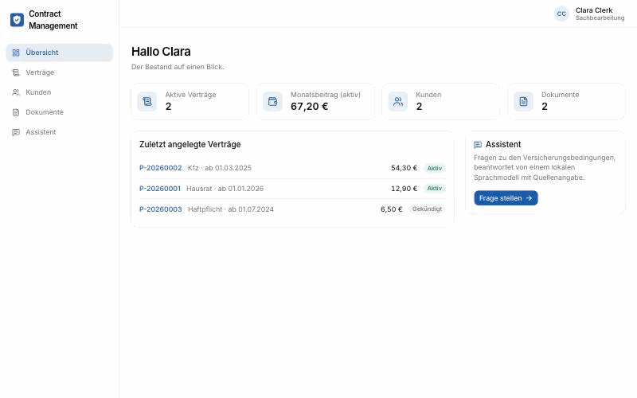
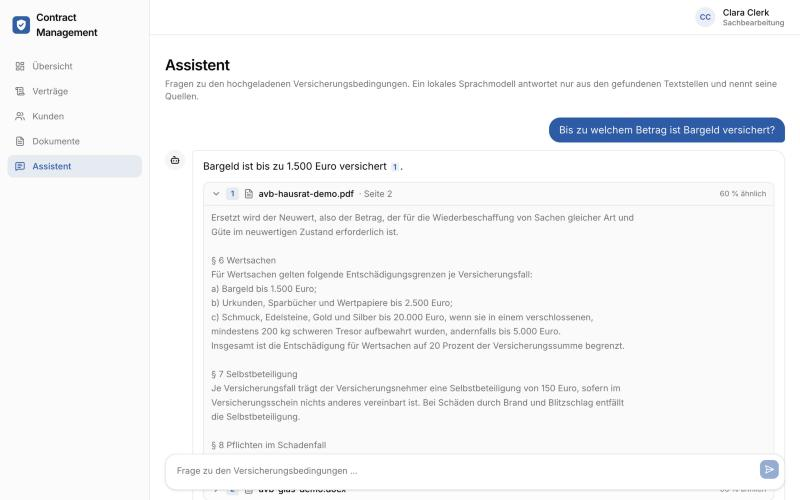
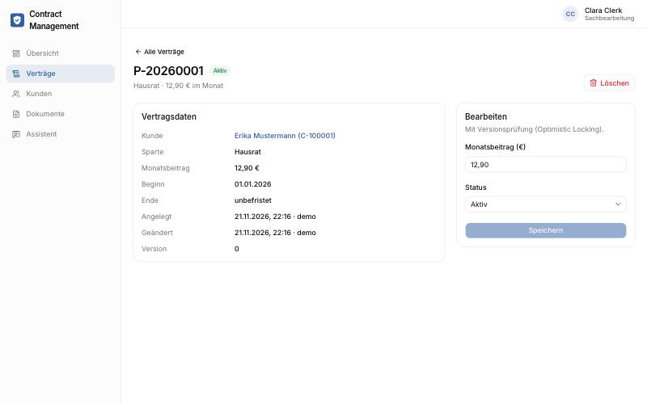
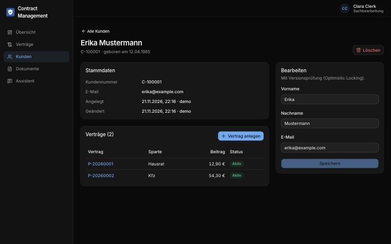
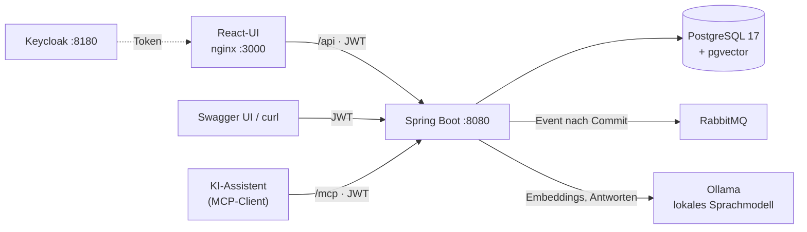

# Contract Management

[](https://github.com/Yusuf-Akcay/contract-management/actions/workflows/ci.yml)

Ein kleines, vollständiges **Bestandsführungssystem für Versicherungen**: Kunden und Verträge verwalten, Versicherungsbedingungen hochladen und Fragen dazu stellen. Die Antworten formuliert ein lokales Sprachmodell, mit Quellenangabe, ohne Cloud und ohne API-Key.



*Antworten vom lokalen Sprachmodell `qwen2.5:3b` über Ollama. Die Versicherungsbedingungen sind fiktiv.*

## Worum es geht

Sachbearbeiter legen Kunden und Verträge an und pflegen sie, Prüfer sehen dieselben Daten nur lesend. Zu jedem Produkt gibt es Versicherungsbedingungen, oft viele Seiten lang. Statt sie durchzublättern, fragt man den Assistenten, etwa „Ist mein Fahrrad gegen Diebstahl versichert?“, und bekommt eine kurze Antwort mit Verweis auf die Fundstelle im Dokument.

Dieses Repository ist das **Backend (API)**. Die Oberfläche ist ein eigenes React-Projekt: **[contract-management-ui](https://github.com/Yusuf-Akcay/contract-management-ui)**. Ein Befehl startet beides.

## Was das Projekt zeigt

- **REST-API mit Java 25 und Spring Boot 4**: sauber geschichtet, validiert, dokumentiert (Swagger UI)
- **Sicherheit mit Keycloak**: OAuth2/JWT, zwei Rollen (lesen / schreiben), die Oberfläche meldet sich per Authorization Code + PKCE an
- **Anbindung anderer Systeme**: nach dem Anlegen eines Vertrags geht ein Event über **RabbitMQ** raus
- **RAG ohne Cloud**: PDF oder DOCX hochladen, die Texte landen als Vektoren in **PostgreSQL/pgvector**, ein **lokales Sprachmodell (Ollama)** beantwortet Fragen dazu
- **KI-Integration per MCP**: die Anwendung ist selbst ein **MCP-Server**, ein KI-Assistent kann Verträge und Dokumente darüber nur lesend abfragen
- **Automatisierte Qualität**: Unit-, Slice- und Integrationstests mit Testcontainers, Smoke-Test gegen den kompletten Stack, CI mit veröffentlichtem Docker-Image

| Assistent mit Quelle | Vertrag bearbeiten | Dark Mode |
|---|---|---|
| [](docs/screenshots/05-assistent-quelle.jpg) | [](docs/screenshots/03-vertrag.jpg) | [](docs/screenshots/07-kunde-dunkel.jpg) |

## Schnellstart: nur Docker nötig

Kein Java, kein Node: Die Pipelines veröffentlichen fertige Images (amd64 + arm64) auf `ghcr.io`.

```bash
git clone https://github.com/Yusuf-Akcay/contract-management.git && cd contract-management
docker compose --profile app --profile rag --profile ui up -d
```

Beim ersten Start lädt Compose die Sprachmodelle (~3 GB), das dauert einige Minuten. Danach:

- **Oberfläche: http://localhost:3000**, anmelden mit `clerk` / `demo` (alles) oder `auditor` / `demo` (nur lesen). Die fiktiven Hausrat-Bedingungen sind schon importiert, zum Hochladen liegt `samples/avb-glas-demo.docx` bereit.
- **Swagger UI:** http://localhost:8080/swagger-ui.html
- **Alles prüfen** (braucht `curl` + `jq`): `SMOKE_RAG=1 ./scripts/smoke-test.sh`
- **Beenden:** `docker compose --profile app --profile rag --profile ui down`

## Architektur



Package-by-Feature: `customer/`, `contract/`, `document/` (je `domain`, `service`, `web`, …) und `shared/` (Security, Fehlerbehandlung, Basis-Entity).

**Fragen an Dokumente (RAG):**

```
Upload → Text je Seite → Abschnitte à ~300 Tokens → Vektoren (bge-m3) → pgvector
Frage  → 4 ähnlichste Abschnitte → Prompt mit Auszügen → qwen2.5:3b → Antwort + Quellen
```

**Tech-Stack:** Java 25 · Spring Boot 4.1 · Spring Security · Spring Data JPA / Hibernate 7 · Flyway · PostgreSQL 17 + pgvector · Spring AI 2.0 (Ollama, PgVectorStore, MCP Server) · Keycloak 26 · RabbitMQ 4 · MapStruct · Lombok · springdoc-openapi · JUnit 5 · Mockito · AssertJ · Testcontainers

## Bewusste Entscheidungen

- **Alles lokal, kein API-Key.** Embeddings und Antworten kommen von Ollama. Die Modelle sind per Umgebungsvariable austauschbar, die Größe der Vektorspalte setzt Flyway über einen Platzhalter.
- **Retrieval und Generierung getrennt programmiert** statt über den fertigen `QuestionAnswerAdvisor`. So liefert die API genau die Abschnitte mit, auf denen die Antwort beruht (Datei, Seite, Ähnlichkeit), und die Oberfläche verlinkt die Zitate `[1]`, `[2]` mit der Quelle.
- **Ohne Treffer kein Modellaufruf.** Abschnitte unter 35 % Ähnlichkeit werden verworfen. Bleibt nichts übrig, etwa bei „Wer hat die WM 2014 gewonnen?“, antwortet die API sofort ohne Modell, und es kann nichts erfunden werden.
- **Dateityp aus dem Inhalt**, nicht aus Dateiname oder Header (Apache Tika). Metadaten und Vektoren werden in einer Transaktion gespeichert, ein fehlgeschlagenes Embedding hinterlässt keinen halben Import.
- **Einheitliche Fehler nach RFC 7807** (`ProblemDetail`), bei Validierung mit Feldfehlern `errors[]`. Gleichzeitige Änderungen fängt Optimistic Locking ab (`@Version` → `409`).
- **Event erst nach dem Commit** (`AFTER_COMMIT`), der Listener hat Retry und Dead-Letter-Queue. Für garantierte Zustellung wäre eine Transactional Outbox der nächste Schritt.
- **Liveness prüft keine externen Systeme**, RabbitMQ und Ollama gehören nicht zur Readiness. Fällt einer davon aus, antworten nur die betroffenen Funktionen mit `503`, statt die ganze API vom Netz zu nehmen.
- **MCP nur lesend und nur mit Leserolle**, Parameter werden wie bei REST validiert.

## Tests und CI

```bash
./mvnw verify
```

- **Unit und Validierung:** Services, JWT-Rollen-Mapping, Textextraktion (PDF mit Seitenzahlen, DOCX), eigenes Constraint `@ValidDateRange`
- **Web- und JPA-Slices:** 401/403/400/404/409 mit `ProblemDetail`, Suche, Auditing, Optimistic Locking, gegen echtes PostgreSQL (Testcontainers)
- **Integration:** Vertrag per REST anlegen → Event nach Commit → per MCP auffindbar; RAG mit echtem pgvector und echtem PDF-/DOCX-Parsing, nur die Modelle sind ersetzt
- **Smoke-Test** gegen den kompletten Stack mit echtem Keycloak, RabbitMQ, PostgreSQL und Ollama

| Stufe | Was passiert |
|---|---|
| test | Unit- und Slice-Tests |
| verify | zusätzlich Integrationstests, JAR |
| docker | Image aus dem JAR bauen |
| smoke | kompletten Stack starten, `scripts/smoke-test.sh` inkl. Upload und Frage |
| publish | nur `main`: Multi-Arch-Image nach `ghcr.io` |

Aktiv ist GitHub Actions; `.gitlab-ci.yml` bildet dieselben Stufen als Vorlage für GitLab ab. Es wird nichts deployt.

## Details

<details>
<summary><b>Umsetzung im Überblick</b></summary>

| Thema | Umsetzung |
|-------|-----------|
| Domäne | `Customer` 1:n `Contract` (contractNumber, lineOfBusiness, premium, startDate, endDate, status); `UploadedDocument` mit seinen Text-Abschnitten im Vektorspeicher |
| Persistenz | PostgreSQL 17 mit pgvector, JPA/Hibernate 7, Flyway-Migrationen (auch die Vektortabelle samt HNSW-Index), `ddl-auto: validate`, `@Version`, JPA-Auditing (`createdBy` aus dem JWT) |
| Abfragen | Derived Queries, dynamische Suche per Query by Example (ohne EntityManager), alle Listen als `Page<Dto>` |
| Validierung | Bean Validation auf Request-Records, eigenes Klassen-Constraint `@ValidDateRange`, Dateityp aus dem Inhalt (Tika) |
| Fehler | RFC 7807 `ProblemDetail`; 404, 409, 413 (> 10 MB), 415 (kein PDF/DOCX), 422 (kein Text, z. B. Scan), 503 (Ollama nicht erreichbar) |
| Security | OAuth2 Resource Server, Keycloak-Realm-Rollen → `ROLE_*`, Audience-Prüfung, Method Security über Meta-Annotationen (`@ReadAccess`, `@WriteAccess`) |
| Messaging | Domain-Event → nach Commit nach RabbitMQ (Topic-Exchange), Listener mit Retry + Dead-Letter-Queue |
| RAG | Spring AI 2.0: `PagePdfDocumentReader` bzw. `TikaDocumentReader` → `TokenTextSplitter` (~300 Tokens) → `PgVectorStore` (Cosinus, HNSW) → Top-4-Abschnitte als nummerierter Kontext → `ChatClient` mit Ollama |
| MCP | Spring AI MCP Server (Streamable HTTP, `/mcp`), vier Read-only-Tools |

</details>

<details>
<summary><b>Entwicklung: lokal starten, Benutzer, Token</b></summary>

Voraussetzungen: **Docker** (z. B. Rancher Desktop mit dockerd/moby), **Java 25** (Maven nicht nötig, Wrapper `./mvnw`), für Upload und Fragen **Ollama** (als Container über `--profile rag` oder nativ).

**1. Infrastruktur starten** (PostgreSQL, RabbitMQ, Keycloak):

```bash
docker compose up -d
```

- PostgreSQL: `localhost:5432`, Datenbank `contract_management`, `contract` / `contract`
- Keycloak: http://localhost:8180 (Admin `admin` / `admin`), der Realm wird aus `keycloak/contract-management-realm.json` importiert
- RabbitMQ Management: http://localhost:15672 (`guest` / `guest`)

**2. Anwendung starten:**

```bash
./mvnw spring-boot:run -Dspring-boot.run.profiles=local
```

Das Profil `local` lädt Demodaten (2 Kunden, 3 Verträge) und importiert die Hausrat-Bedingungen, sofern Ollama läuft. Alternativ alles im Container mit lokal gebautem Image: `./mvnw -DskipTests package && docker compose --profile app --profile rag up -d --build`. Das `Dockerfile` packt das JAR in Schichten und startet es als Nicht-Root-User.

Ein Detail zu Keycloak im Container: Das Token wird über `localhost:8180` geholt, also steht im Token `iss = http://localhost:8180/...`. Die App prüft den Issuer deshalb gegen `localhost:8180`, lädt die Signaturschlüssel aber direkt über das Compose-Netz (`SPRING_SECURITY_OAUTH2_RESOURCESERVER_JWT_JWK_SET_URI=http://keycloak:8080/...`).

**Demo-Benutzer:**

| Benutzer | Passwort | Rollen | Darf |
|----------|----------|--------|------|
| `clerk` | `demo` | `contract-write` (enthält `contract-read`) | alles, auch Dokumente hochladen und löschen |
| `auditor` | `demo` | `contract-read` | nur lesen und fragen (+ MCP) |

Der Realm hat zwei öffentliche Clients: `contract-management` für curl, Swagger und den Smoke-Test (nur Password-Grant) und `contract-management-ui` für das React-Frontend (Authorization Code mit erzwungenem PKCE).

**Token holen und API aufrufen** (Password-Grant nur für die Demo, produktiv gehört er abgeschaltet):

```bash
TOKEN=$(curl -s -X POST http://localhost:8180/realms/contract-management/protocol/openid-connect/token \
  -d grant_type=password -d client_id=contract-management \
  -d username=clerk -d password=demo | jq -r .access_token)

# Lesen
curl -s -H "Authorization: Bearer $TOKEN" "http://localhost:8080/api/contracts?lineOfBusiness=MOTOR" | jq

# Schreiben → 201, danach im App-Log: "ContractCreated received: P-20260042 ..."
curl -s -X POST http://localhost:8080/api/contracts -H "Authorization: Bearer $TOKEN" -H "Content-Type: application/json" \
  -d '{"contractNumber":"P-20260042","customerId":1,"lineOfBusiness":"HOUSEHOLD","premium":12.90,"startDate":"2026-01-01"}' | jq

# Ungültig → 400 ProblemDetail mit errors[]
curl -s -X POST http://localhost:8080/api/contracts -H "Authorization: Bearer $TOKEN" -H "Content-Type: application/json" \
  -d '{"contractNumber":"X1","customerId":1,"lineOfBusiness":"MOTOR","premium":-5,"startDate":"2026-01-01","endDate":"2025-01-01"}' | jq
```

Mit dem Token von `auditor` liefert der POST `403`. In der Swagger UI das Token über „Authorize“ eintragen, OpenAPI-JSON unter http://localhost:8080/v3/api-docs.

**Aufräumen:**

```bash
docker compose --profile app --profile rag --profile ui down      # Modelle bleiben im Volume
docker compose --profile app --profile rag --profile ui down -v   # inkl. Datenbank und Modelle (~3 GB)
```

</details>

<details>
<summary><b>RAG im Detail: Modelle, Prompt, Grenzen</b></summary>

- **`bge-m3` als Embedding-Modell**, weil es mehrsprachig ist und deutsche Fachtexte deutlich besser trifft als rein englische Modelle. **`qwen2.5:3b`** antwortet ordentlich auf Deutsch: mit Apple-GPU in 2–5 Sekunden, nur auf der CPU (Docker) in 10–30 Sekunden.
- **Deutscher System-Prompt, Zitate per Auszugsnummer.** Mit englischem Prompt antwortet ein 3B-Modell oft auf Englisch. Die Auszüge stehen in `<auszug nr="…">`-Tags, damit das Modell sie nicht mit der Antwort vermischt.
- **Obergrenze von 400 Tokens je Antwort** (`num-predict`). Kleine Modelle geraten gelegentlich in eine Endlosschleife, ohne Grenze blockiert so eine Anfrage das Modell minutenlang.
- **Grenzen eines 3B-Modells:** Die Treffer stimmen fast immer, die Formulierung nicht immer. Mit `OLLAMA_CHAT_MODEL=qwen2.5:7b` werden die Antworten genauer, brauchen aber ~5 GB RAM mehr.
- **Im Profil `local` wird `avb-hausrat-demo.pdf` beim ersten Start importiert**, damit man sofort fragen kann. Ist Ollama nicht erreichbar, startet die App trotzdem.
- Die Beispieldokumente (`src/main/resources/demo/avb-hausrat-demo.pdf`, `samples/avb-glas-demo.docx`) sind selbst geschriebene, **fiktive** Bedingungen.

```bash
# Hochladen (Rolle contract-write) → 201 mit Anzahl der Abschnitte
curl -s -X POST http://localhost:8080/api/documents -H "Authorization: Bearer $TOKEN" -F file=@samples/avb-glas-demo.docx | jq

# Fragen (Rolle contract-read) → Antwort + Quellen
curl -s -X POST http://localhost:8080/api/documents/ask -H "Authorization: Bearer $TOKEN" -H "Content-Type: application/json" \
  -d '{"question":"Ist ein gesprungenes Ceranfeld versichert?"}' | jq
```

**Ollama auf dem Mac besser nativ:** In Docker läuft Ollama auf dem Mac nur auf der CPU, weil Container nicht an die Apple-GPU kommen. Nativ ist es um ein Vielfaches schneller:

```bash
brew install ollama && brew services start ollama
ollama pull bge-m3 && ollama pull qwen2.5:3b
OLLAMA_BASE_URL=http://host.docker.internal:11434 docker compose --profile app --profile ui up -d
```

</details>

<details>
<summary><b>MCP-Server: Tools und Anbindung</b></summary>

Unter `http://localhost:8080/mcp` (Streamable HTTP), nur mit Bearer-Token und Rolle `contract-read`.

| Tool | Zweck |
|------|-------|
| `search_contracts` | Verträge optional nach Sparte und Status filtern (max. 20) |
| `contracts_of_customer` | Verträge zu einer Kundennummer, z. B. `C-100001` |
| `contract_details` | ein Vertrag zu einer Vertragsnummer, z. B. `P-20260001` |
| `search_documents` | semantische Suche in den Dokumenten, liefert die Abschnitte mit Datei und Seite; die Antwort formuliert der KI-Client selbst |

**MCP Inspector:** Transport „Streamable HTTP“, URL `http://localhost:8080/mcp`, Header `Authorization: Bearer <TOKEN>` → Connect → Tools → List Tools.

**Claude Desktop** (`claude_desktop_config.json`) über die Bridge `mcp-remote`:

```json
{
  "mcpServers": {
    "contract-management": {
      "command": "npx",
      "args": ["mcp-remote", "http://localhost:8080/mcp", "--header", "Authorization:${AUTH_HEADER}"],
      "env": { "AUTH_HEADER": "Bearer <access_token von auditor>" }
    }
  }
}
```

Das Access-Token ist 15 Minuten gültig. Für den Dauerbetrieb wäre ein eigener Keycloak-Client mit Client-Credentials der nächste Schritt.

</details>

<details>
<summary><b>Health-Checks und Kubernetes</b></summary>

| Endpoint | Kurzform | Prüft | Bei Problem |
|----------|----------|-------|-------------|
| `/actuator/health/liveness` | `/livez` | nur den internen Zustand der App | `503` → Kubernetes startet den Pod neu |
| `/actuator/health/readiness` | `/readyz` | Bereitschaft + Datenbank | `503` → Pod bekommt keinen Traffic mehr |

Beide sind ohne Token erreichbar. `/actuator/health` (Gesamtstatus) enthält RabbitMQ weiterhin und meldet ohne Broker `DOWN`.

```yaml
livenessProbe:
  httpGet: { path: /livez, port: 8080 }
  periodSeconds: 10
readinessProbe:
  httpGet: { path: /readyz, port: 8080 }
  periodSeconds: 5
startupProbe:
  httpGet: { path: /livez, port: 8080 }
  failureThreshold: 30
  periodSeconds: 2
```

</details>

<details>
<summary><b>Tests und CI im Detail</b></summary>

Die Datenbanktests laufen mit **Testcontainers** gegen dasselbe Image wie in Compose (`pgvector/pgvector:pg17`). Mit **Rancher Desktop** findet Testcontainers den Docker-Socket nicht von selbst:

```bash
export DOCKER_HOST=unix://$HOME/.rd/docker.sock TESTCONTAINERS_DOCKER_SOCKET_OVERRIDE=/var/run/docker.sock
```

- **Unit** (Mockito): `ContractServiceTest`, `KeycloakJwtAuthenticationConverterTest`, `DocumentTextExtractorTest`
- **Validierung:** `CreateContractRequestValidationTest` (inkl. `@ValidDateRange`)
- **Web-Slice** (`@WebMvcTest` + `jwt()`): 401/403/201/400/404/409, Feldfehler, Paging
- **JPA-Slice** (`@DataJpaTest` + Testcontainers + Flyway): Query by Example, Derived Query, Auditing, Optimistic Locking
- **Integration** (`ContractCreationIT`): Kunde + Vertrag per REST → Event nach Commit → Duplikat 409 → MCP findet den Vertrag; MCP lehnt leere Parameter ab
- **RAG** (`DocumentRagIT`): echtes pgvector und Parsing, deterministisches Bag-of-Words-Embedding statt Modell, gemocktes Chat-Modell; Upload → richtige Seite gefunden → Prompt enthält die Auszüge; Löschen entfernt die Vektoren; 403/415/400/503
- **Health-Probes** (`HealthProbesIT`): nach `REFUSING_TRAFFIC` liefert `/readyz` `503`, `/livez` bleibt `200`

Im Smoke-Test der CI laufen bewusst **sehr kleine Modelle** (`all-minilm` + `qwen2.5:0.5b`, ~0,5 GB statt ~3 GB). Geprüft wird die Verkabelung, nicht die Qualität der Antwort; die Vektorspalte bekommt dafür per `EMBEDDING_DIMENSIONS=384` die passende Größe. Die Oberfläche prüfen die Playwright-Tests im UI-Repository gegen genau diesen Stack.

Das Image veröffentlicht GitHub erst, wenn alle Stufen grün sind (Tags `latest` und `sha-<commit>`, nur dieser Job hat `packages: write`). Die GitLab-Vorlage endet beim Smoke-Test und nutzt Docker als Service (`docker:dind`): Testcontainers spricht ihn über `DOCKER_HOST=tcp://docker:2375` an, die Ports des Stacks liegen unter dem Host `docker`. Damit das Token trotzdem den Issuer `http://localhost:8180` trägt, ist in Keycloak `KC_HOSTNAME` fest gesetzt.

</details>
